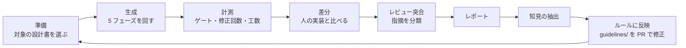

# 評価ループ（AI 生成の精度を上げる）

同じ設計書を **AI が生成したもの** と **人が実装したもの** で比べ、差分からルール（guidelines/）を直して、次の生成で効果を確かめます。



## ラン ID

`run-YYYYMMDD-<機能 ID>-<gen|human>-<連番 2 桁>`　例: `run-20261005-JOB0001-gen-01`

## 置き場

| フォルダ | 内容 |
|---|---|
| `runs/<ラン ID>/` | ラン記録（[templates/run-record.md](templates/run-record.md)）、ゲート結果、判定表 |
| `insights/` | 知見（何をどのルールに反映したか） |
| `metrics.csv` | 世代ごとの指標（1 ラン 1 行） |

## 指標（metrics.csv）

| 列 | 意味 |
|---|---|
| run_id | ラン ID |
| guideline_rev | そのときの guidelines/ のコミット |
| auto_fix_count | 自動修正の回数（全フェーズ合計） |
| gate_fail_first | 初回に落ちたゲート（例 `D2;D4`） |
| review_must / review_want / review_nits | 人のレビューの指摘数 |
| branch_coverage | 分岐網羅率 |
| human_minutes | 人が使った時間（分） |
| escalated | 自動修正が収束せず人に戻ったか（0/1） |

指摘の分類と傾向分析は quality-analytics で行えます（MUST / WANT / NITS / Q の区分を共通にしています）。

## 計測の状況

**まだ計測していません。** `metrics.csv` は見出しの行だけで、データはありません（`runs/`・`insights/` も空）。
数字は実際のランの記録だけから書き、見込みや例の値で埋めないでください。

## 運用の流れ（誰が・いつ）

| いつ | 誰が | すること |
|---|---|---|
| 機能を 1 つ AI で作るたび（5 フェーズの完了時） | 実行した人 | 下の「計測の手順」でラン記録を書き、`metrics.csv` に 1 行足す PR を出す |
| 同じ設計書を人も実装したとき | 実装した人 | `human` のラン ID で同じ記録を取る（比べる相手） |
| 月に 1 回 | guidelines の担当 | `metrics.csv` の推移（自動修正の回数・初回に落ちたゲート・人の時間）を見て、増えている項目の原因を `insights/` に書き、guidelines を直す PR を出す |
| guidelines を直した後の次のラン | 実行した人 | `guideline_rev` が変わったことで、直した効果を前のランと比べる |

`metrics.csv` に足すのは **実際に回したランの値だけ** です。下の例は書き方を示す架空の値で、`metrics.csv` には入れません。

### 最初の記録の例（架空）

架空の機能 `JOB9001` を AI で作ったとした場合の記録です（値はすべて例）。

`runs/run-20261020-JOB9001-gen-01/README.md`（[templates/run-record.md](templates/run-record.md) を写したもの）の要点:

| フェーズ | 自動修正の回数 | 初回に落ちたゲート | 人のレビュー指摘（MUST / WANT / NITS / Q） | 所要時間（分） |
|---|---|---|---|---|
| 1 計画 | - | - | 0 / 1 / 0 / 1 | 15 |
| 2 コード生成 | 2 | D2;D5 | 1 / 2 / 3 / 0 | 25 |
| 3 テスト生成 | 1 | D4 | 0 / 1 / 1 / 0 | 20 |
| 4 突合 | - | - | 0 / 0 / 0 / 0 | 5 |
| 5 CI + PR | 0 | - | 0 / 0 / 1 / 0 | 10 |

`metrics.csv` に足す 1 行（見出しの列の順）:

```csv
run-20261020-JOB9001-gen-01,0123abc,3,D2;D5;D4,1,4,5,0.85,75,0
```

- `auto_fix_count` は全フェーズの合計（2 + 1 + 0 = 3）、`gate_fail_first` は初回に落ちたゲートを出た順に `;` でつなぐ
- `review_must` / `review_want` / `review_nits` はフェーズの合計（Q は数えない）、`human_minutes` は所要時間の合計
- `branch_coverage` は 0〜1 の小数（85% なら 0.85）、`escalated` は人に戻ったら 1

## 計測の手順（1 ラン）

1. ラン ID を決め、`runs/<ラン ID>/` を作って [templates/run-record.md](templates/run-record.md) を写す
2. `git rev-parse HEAD` で guidelines/ のコミットを控える（`guideline_rev`）
3. 5 フェーズを回す（人の実装と比べるときは、同じ設計書を人も実装し、ラン ID の `human` で同じ記録を取る）
4. 各フェーズで、エージェントの自動修正の回数・初回に落ちたゲート・人に戻ったかを、ラン記録に書く
5. `./scripts/verify-gates.sh --final`（Windows は `.\scripts\verify-gates.ps1 -Final`）の結果の表をラン記録に貼る
6. 分岐網羅率は `template/build/reports/jacoco/test/html/index.html` の Branches の値（Service・Job）を書く
7. RP2〜RP5 のレビュー指摘を MUST / WANT / NITS で数える。人が使った時間は作業ごとに分で記録して合計する
8. 上の値を `metrics.csv` に 1 行足す（列の順は見出しのとおり。値が無い列は空にし、推測で埋めない）
9. 差分から得た知見を `insights/` に書き、反映した guidelines/ の PR を記録する
