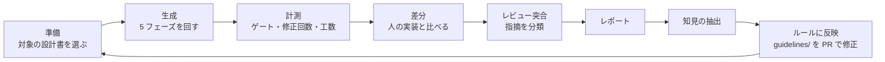

# 評価ループ（AI 生成の精度を上げる）

同じ設計書を **AI が生成したもの** と **人が実装したもの** で比べ、差分からルール（guidelines/）を直して、次の生成で効果を確かめます。

## ラン ID

`run-YYYYMMDD-<機能 ID>-<gen|human>-<連番 2 桁>`　例: `run-20261005-JOB0001-gen-01`

## 置き場

| フォルダ | 内容 |
|---|---|
| `runs/<ラン ID>/` | ラン記録（[templates/run-record.md](templates/run-record.md)）、ゲート結果、判定表 |
| `insights/` | 知見（何をどのルールに反映したか） |
| `metrics.csv` | 世代ごとの指標（1 ラン 1 行） |

## 指標（metrics.csv）

| 列 | 意味 |
|---|---|
| run_id | ラン ID |
| guideline_rev | そのときの guidelines/ のコミット |
| auto_fix_count | 自動修正の回数（全フェーズ合計） |
| gate_fail_first | 初回に落ちたゲート（例 `D2;D4`） |
| review_must / review_want / review_nits | 人のレビューの指摘数 |
| branch_coverage | 分岐網羅率 |
| human_minutes | 人が使った時間（分） |
| escalated | 自動修正が収束せず人に戻ったか（0/1） |

指摘の分類と傾向分析は quality-analytics で行えます（MUST / WANT / NITS / Q の区分を共通にしています）。
