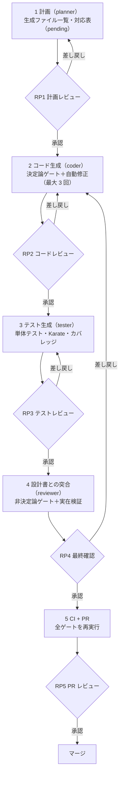

# 進め方（5 フェーズと人のレビュー）

| フェーズ | 担当エージェント | 入力 | 出力 | 終わりの条件 |
|---|---|---|---|---|
| 1 計画 | planner | 設計書（ID で特定） | 生成ファイル一覧、`traceability/specs/<機能>.yaml`（全要件 pending） | 人が RP1 で承認し、`spec-trace pin` を実行 |
| 2 コード生成 | coder | 計画、guidelines | ソース一式。対応表の implements を書き implemented に | `./gradlew qualityGate` の D1・D2・D5・D9 が通る、RP2 承認 |
| 3 テスト生成 | tester | ソース、設計書 | 単体テスト、Karate シナリオ。proofs を書き proven に | D3・D4・D6〜D8・D10 が通る、RP3 承認 |
| 4 突合 | reviewer | 設計書、ソース、テスト | 非決定論ゲート N1〜N6 の判定表 | 指摘 0 または全件を人が判断、RP4 承認 |
| 5 CI + PR | orchestrator | 全成果物 | PR（判定表・ゲート結果を本文に添付） | CI が全て通る、RP5 承認 |

## 自動修正ループの止め方

ゲートが通らないとき、エージェントは原因を直して再実行します。ただし次のどれかで **即座に止めて人に戻します**。

- 同じフェーズで **3 回** 直しても通らない
- 同じエラーが 2 回続いた（直せていない）
- A → B → A のように同じ修正を行き来している
- 直すたびにエラーが増えている

人に戻すときは、各回の「直した内容の要約」「エラーの推移」「収束しないと判断した理由」を添えます。

## 禁止事項（ゲートのこじ開け）

ゲートを通すことを目的にした次の変更は禁止です。エージェントの指示と CI（spec-trace・Checkstyle・SpotBugs の除外レビュー）の両方で防ぎます。

- テストの期待値を、設計書ではなく実装に合わせて書き換える
- アサーションを消す・弱める（`assertTrue(true)` など）、実行するだけのテストにする
- Checkstyle・SpotBugs の除外や `@SuppressWarnings` を理由なく足す
- テストやシナリオを `@Disabled` / `@ignore` で無効化する
- 対応表から要件を消す、状態を根拠なく上げる
- カバレッジの閾値（`branchCoverageMinimum`）を下げる

直せないときは、理由と試したことを添えて人に相談します。

## 設計書の変更（ドリフト）

承認時の設計書のハッシュは対応表の `source_sha256` に記録されています。設計書が変わると CI が `trace.spec_drift` で失敗します。
差分を確認し、影響する要件を pending に戻してフェーズ 1 からやり直します。直したあとの `spec-trace pin` は人がレビュー後に行います。
